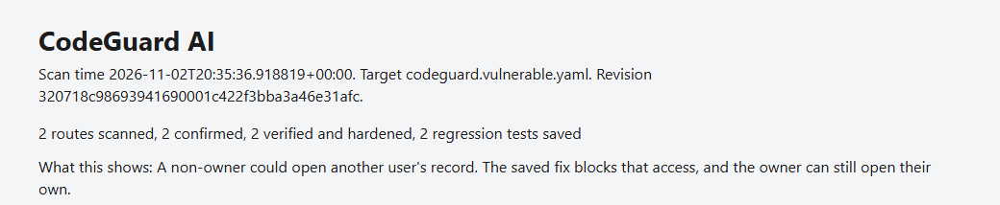
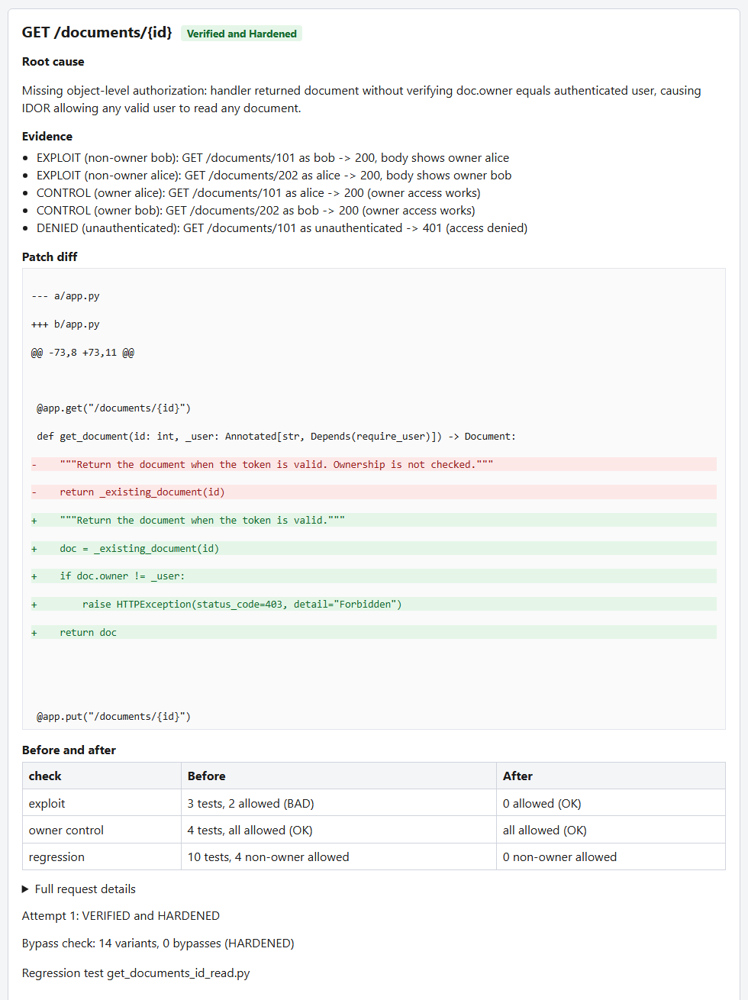
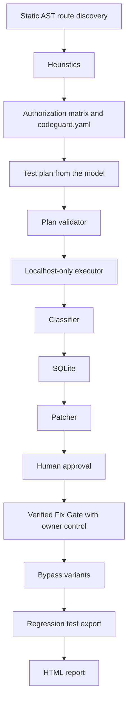

# CodeGuard AI

[](https://github.com/Keerthi156/codeguard-ai/actions/workflows/tests.yml)

CodeGuard AI finds, proves, fixes, verifies, and regression-tests Broken Object Level Authorization (BOLA, OWASP API1) bugs in FastAPI apps. It is an entry for the Meta Global AI Developer Hackathon, Indie Developer track, theme "Push the Frontier" (software).

## Demo
[Watch the 3-minute CodeGuard AI demo](https://youtu.be/ZJ6QcFMy2j0)

Models: Muse Spark 1.3 on the Meta Model API, and Muse Spark Open (`meta-models/muse-spark-open-1026`, open weights, served by Baseten). The agent reads the code through read-only tools, proposes the test plan and the patch, and repairs a failed fix up to twice. Deterministic code, not the model, decides Confirmed and Verified.

Headline results, each measured on small local benchmarks (see the linked files):

- Benchmark, 8 apps, 3 runs ([reports/benchmark_comparison_after_reset.md](reports/benchmark_comparison_after_reset.md)): Muse Spark 1.3 and a no-model run both confirmed 21 of 21 vulnerable-route runs (7 vulnerable routes × 3 runs) with 0 false positives. Muse Spark Open confirmed all 20 scored runs; 1 run errored and is excluded. A rerun on the final code (`reports/benchmark_comparison_final.md`) confirmed 21 of 21 for Muse Spark 1.3, Muse Spark Open, and the no-model run, with no errors. None of the 8 apps is held out.
- Fix loop, 20 findings per model ([reports/reliability_baseten_after_guard.md](reports/reliability_baseten_after_guard.md) for Muse Spark Open, [reports/reliability_meta_after_guard.md](reports/reliability_meta_after_guard.md) for Muse Spark 1.3): 20 of 20 verified on the first attempt for each (10 runs × the 2 routes of the document fixture).
- Ten apps written by Muse Spark 1.3 ([reports/ai_written_apps_run3.md](reports/ai_written_apps_run3.md)): 0 confirmed findings, 14 routes not judgeable (collection routes), 2 apps did not start, 1 stopped at a tool-call limit.

This entry targets the open-weights category (the Muse Spark Open runs) and the agentic-use category. It does not claim either.

A scan reads the app with the Python `ast` module, asks a model for a test plan, sends those tests only to localhost, and records a finding as Confirmed only when deterministic code sees unauthorized access and a passing owner control. A fix is applied only on a temporary copy, and only after a typed `y`.

## The problem

Changing an object id in a request can return another user's record. Ordinary tests usually call the route as the owner, so they do not show what a different user can do. This repository does not claim that AI-written code often lacks authorization checks. In the sample under `experiments/ai_written/`, the hand-check in [experiments/ai_written/review.yaml](experiments/ai_written/review.yaml) records an owner comparison on every `GET /{id}` and `DELETE /{id}` handler (bookmarks uses the field `user`). The generation prompt in [experiments/ai_written/PROMPT.md](experiments/ai_written/PROMPT.md) says each item belongs to a user and tells the model to seed owner data, which may have primed those checks.

## What it does

There is no separate `verify` subcommand. `fix` proposes a patch and runs the Verified Fix Gate.

1. Scan: `python -m app.cli scan --config fixtures/codeguard.vulnerable.yaml`
2. The scan stores findings in SQLite. Confirmed is decided by `app/findings/classifier.py`, not by the model.
3. Fix: `python -m app.cli fix --config fixtures/codeguard.vulnerable.yaml`
4. Verify: the same `fix` command re-tests the patch on a temporary copy. Approval is the prompt `Apply this fix for {id}? Type y to approve:` in `app/remediation/verifier.py`.
5. Regress: `python -m app.cli regress --config fixtures/codeguard.vulnerable.yaml`
6. Report: `python -m app.cli report --config fixtures/codeguard.vulnerable.yaml`

## Demo

The fixture commands above are the ones in the `app/cli.py` module docstring. With `USE_MOCK_AI=true` (development only; see `app/ai/factory.py`), a scan of `fixtures/codeguard.vulnerable.yaml` prints two Confirmed routes. One evidence line is:

```text
EXPLOIT: GET /documents/101 as bob -> 200, body shows owner alice
```

The same scan prints `2 findings, 2 confirmed`. [reports/latest.html](reports/latest.html) is the single static page written by `report` (default `--out reports/latest.html`). The committed page says `2 routes scanned, 2 confirmed, 2 verified and hardened, 2 regression tests saved` and contains both of these lines:

```text
EXPLOIT (non-owner bob): GET /documents/101 as bob -> 200, body shows owner alice
Attempt 1: VERIFIED and HARDENED
```





The fixtures are intentionally vulnerable and are for local use only.

## Models

`app/config.py` selects `meta`, `baseten`, or `fireworks` from `--provider` or `PROVIDER`. Each provider reads its own `*_API_KEY`, `*_MODEL`, and `*_BASE_URL`. If no provider is set, `MODEL_API_KEY`, `MODEL_NAME`, and `MODEL_BASE_URL` are used. The base URL is not hardcoded. `app/ai/factory.py` sends Meta, Baseten, and Fireworks through one OpenAI-compatible client. `MockProvider` is used only when `USE_MOCK_AI` is true, and a model failure is not replaced with the mock.

Measured reports name two models. Muse Spark 1.3 is served by the Meta Model API. The open-weights model is Muse Spark Open, and its measured runs were served by Baseten. Meta runs use `muse-spark-1.3` ([reports/benchmark_meta_after_reset.md](reports/benchmark_meta_after_reset.md), [reports/reliability_meta.md](reports/reliability_meta.md)). Baseten runs use `meta-models/muse-spark-open-1026` ([reports/benchmark_baseten_after_reset.md](reports/benchmark_baseten_after_reset.md), [reports/reliability_baseten.md](reports/reliability_baseten.md)). The generated apps were also written with `muse-spark-1.3` ([experiments/ai_written/PROMPT.md](experiments/ai_written/PROMPT.md)). Fireworks is accepted by configuration and by `--provider`. No report under `reports/` records a Fireworks run.

The model does three things. During a scan it may call only `list_routes`, `read_handler`, `get_matrix`, and `submit_plan` (`app/ai/llm_provider.py`) and must finish with `submit_plan`. For a fix it proposes a structured text edit. `app/remediation/verifier.py` repairs a rejected or failed fix at most twice (`_MAX_REPAIR_ATTEMPTS = 2`). Confirmed and Verified are decided by the classifier and the fix gate, not by the model.

On detection, the required-tests ablation matched the model runs. From [reports/benchmark_comparison_after_reset.md](reports/benchmark_comparison_after_reset.md) (commit `97e81aed1f7dea4299461f5d994ea3ac4902fa20`), meta and `required tests only (no model)` both have 21 true positives, 0 false positives, 0 false negatives, and 21 true negatives. The reliability reports are where the model is measured writing and repairing patches.

## How it works



Safety rules checked in this repository:

- Analysis parses source with `ast`. `app/analyzer/auth_checks.py` says target code is never imported or executed.
- The planning tools are the four names above. `submit_plan` has a strict schema, and `app/ai/validator.py` checks the plan against known routes, users, resources, and the policy before anything is sent.
- `app/runner/executor.py` and `app/target_config.py` allow only `http://127.0.0.1` and `http://localhost`.
- Evidence stored by the classifier is redacted. The `Authorization` header is not stored (`app/runner/executor.py`).
- `app/remediation/patcher.py` and `app/remediation/verifier.py` say the original source directory is never modified. Patches are written on a temporary copy.
- A patch starts only after approval. The product prompt accepts only a typed `y`. Reliability reports instead print `AUTO-APPROVED (measurement mode, temporary copies only)`.
- Timeouts, HTTP 5xx, and a body of `resource deleted earlier in this session` are Inconclusive. The classifier module says they are never exploit evidence.
- Each destructive test runs only after the target is restored, in its own session (`execute_plan` in `app/runner/executor.py`).

## Results

Commit hashes in report headers refer to the private development history, which was squashed into the final commit, so they do not resolve on GitHub. Some runs were made before their code was committed, so a header hash can be older than the code that produced the report. The dates are the reference. Report dates are the `Date` fields in those files; [experiments/ai_written/PROMPT.md](experiments/ai_written/PROMPT.md) says the dates in that file are UTC. The commit "Read each target file once and do not send the same request twice" came after the reports above; a benchmark rerun on the final code is in [reports/benchmark_comparison_final.md](reports/benchmark_comparison_final.md).

### Benchmark

The benchmark has 8 apps (4 vulnerable and secure pairs, 14 labeled routes, 7 of them vulnerable), and each app is scanned 3 times, so the counts below are route-runs: 7 vulnerable routes × 3 runs = 21 possible true positives, and 21 true negatives from the 7 secure routes. The pairs dependency_check and uuid_ids guided later tool changes, so no pair is held out (see [benchmarks/labels.yaml](benchmarks/labels.yaml)).

Before the destructive-state fix, from [reports/benchmark_after_dependency_fix.md](reports/benchmark_after_dependency_fix.md), commit `b7744ab1115061137525061404c4d94b385d5517`, date 2026-10-30, model `meta-models/muse-spark-open-1026`, 3 runs:

| TP | FP | FN | TN | Precision | Recall | Errors |
| --- | --- | --- | --- | --- | --- | --- |
| 18 | 0 | 3 | 21 | 1.00 | 0.86 | 0 |

All 3 false negatives are `Suspected not reproduced`. `DELETE /documents/{id}` on uuid-ids-vulnerable is Suspected on all 3 runs in that file.

The "before" file measured one provider (Muse Spark Open); the "after" file compares three sources, so only the totals for the shared model are comparable. The destructive-state fix was designed against the `uuid_ids` pair, which was already in the benchmark.

After the reset, from [reports/benchmark_comparison_after_reset.md](reports/benchmark_comparison_after_reset.md), commit `97e81aed1f7dea4299461f5d994ea3ac4902fa20`:

| Source | TP | FP | FN | TN | Precision | Recall | Plan validity |
| --- | --- | --- | --- | --- | --- | --- | --- |
| meta | 21 | 0 | 0 | 21 | 1.00 (21/21) | 1.00 (21/21) | 1.00 (94/94) |
| baseten | 20 | 0 | 0 | 21 | 1.00 (20/20) | 1.00 (20/20) | 1.00 (123/123) |
| required tests only (no model) | 21 | 0 | 0 | 21 | 1.00 (21/21) | 1.00 (21/21) | n/a (0/0) |

[reports/benchmark_baseten_after_reset.md](reports/benchmark_baseten_after_reset.md) (same commit, date 2026-11-01) records `Errors: 1` and `Run 1: error: model request failed` for nested-resource-vulnerable `GET /invoices/{invoice_id}/items`. The comparison file shows that run as `error` and the other two as Confirmed. An error is not counted as a true positive, false positive, false negative, or true negative.

On the final code, from `reports/benchmark_comparison_final.md` (commit `e8358e1`, working tree clean, date 2026-11-02):

| Source | TP | FP | FN | TN | Precision | Recall | Plan validity |
| --- | --- | --- | --- | --- | --- | --- | --- |
| meta | 21 | 0 | 0 | 21 | 1.00 (21/21) | 1.00 (21/21) | 1.00 (96/96) |
| baseten | 21 | 0 | 0 | 21 | 1.00 (21/21) | 1.00 (21/21) | 1.00 (136/136) |
| required tests only (no model) | 21 | 0 | 0 | 21 | 1.00 (21/21) | 1.00 (21/21) | n/a (0/0) |

Model runs vary from run to run: the Baseten result here differs from the earlier post-reset run (21 of 21 with no error versus 20 scored runs and 1 error). The no-model row is deterministic.

Commit `e8358e1` is on GitHub, so this hash resolves, unlike the older ones.

### Fix-loop reliability

Each file says `Measured on the benchmark fixtures only; not a claim of real-world reliability.` Each header says `AUTO-APPROVED (measurement mode, temporary copies only)`. The product path still requires a typed `y`.

Baseline, date 2026-10-30, 10 runs, 20 findings, 10 valid runs, 0 failed runs.

| Report | Verified and Hardened on the first attempt | After repair | Not verified and hardened | Patches with at least one style flag |
| --- | --- | --- | --- | --- |
| [reports/reliability_meta.md](reports/reliability_meta.md) | 20 (20/20) | 0 | 0 | 15 of 20 |
| [reports/reliability_baseten.md](reports/reliability_baseten.md) | 20 (20/20) | 0 | 0 | 10 of 20 |

Style flags in [reports/reliability_meta.md](reports/reliability_meta.md): import inside a function 5, owner lookup fallback chain 4, changes more than 8 lines 3, docstring still says ownership is not checked 10. In [reports/reliability_baseten.md](reports/reliability_baseten.md): 3, 3, 0, and 8 for those same four flags.

After the patch-quality guard, date 2026-10-30, same outcome shape: 20 of 20 Verified and Hardened on the first attempt, 0 after repair, 0 not verified. [reports/reliability_meta_after_guard.md](reports/reliability_meta_after_guard.md) and [reports/reliability_baseten_after_guard.md](reports/reliability_baseten_after_guard.md) both say `patches with at least one style flag: 0 of 20`, and all four flag counts are 0.

### AI-written apps

[reports/ai_written_apps_run3.md](reports/ai_written_apps_run3.md) is the latest of the committed experiment reports (commit `5ff4ec4d6db1cf200920dd13f06dbfc5089ac349`, date 2026-11-02, provider baseten, scan model `meta-models/muse-spark-open-1026`, generation model `muse-spark-1.3`, generation date 2026-11-01). The file says: `Small sample of 10 apps from one model and one prompt; not a claim about AI-written code in general.`

| Generated | Runnable | Routes scanned | Confirmed | Not applicable | tool call limit | target did not start |
| --- | --- | --- | --- | --- | --- | --- |
| 10 | 10 | 35 | 0 | 14 | 1 | 2 |

Not applicable is the status `Not applicable: collection route (no resource id)`. `Runnable` means the app passed the safety check and received a config; it does not mean the app started. The tool-call-limit row is journal (`tool call limit of 6 exceeded`). The two apps that did not become ready are invoices and support-tickets. The hand-check column uses [experiments/ai_written/review.yaml](experiments/ai_written/review.yaml), which records `checks_owner` for every listed `GET /{id}` and `DELETE /{id}` route and says there is no false negative. An AI coding agent read each listed `GET /{id}` and `DELETE /{id}` handler and recorded the results in [experiments/ai_written/review.yaml](experiments/ai_written/review.yaml).

Earlier committed reports, not the final one:

| File | Commit in the header | Confirmed | Routes scanned | Notes in that file |
| --- | --- | --- | --- | --- |
| [reports/ai_written_apps_run1.md](reports/ai_written_apps_run1.md) (same header commit as [reports/ai_written_apps.md](reports/ai_written_apps.md)) | `fbf687991ecf6456b626e3a039a33deaebd16492` | 0 | 35 | Generated 10, Runnable 10. No Not applicable total and no error-category totals. |
| [reports/ai_written_apps_run2.md](reports/ai_written_apps_run2.md) | `f44d3dc68e556a583a35cb4441f0047800dcc3b0` | 0 | 35 | `tool call limit: 0`, `target did not start: 2` (invoices and support-tickets). |

## Limits and known issues

- Targets are localhost fixtures and the benchmark apps. Reports say they are not a claim of real-world coverage.
- A route with no path parameter is not tested for object-level access. Run 3 counts 14 of those as Not applicable.
- [reports/ai_written_apps_run3.md](reports/ai_written_apps_run3.md) states: destructive routes on slow-starting apps time out. Invoices and support-tickets did not become ready.
- Heuristics follow calls in the same file and one level of `Depends`. `app/analyzer/auth_checks.py` says nested dependencies are not entered.
- `async def` handlers are included: `app/analyzer/routes.py` walks `AsyncFunctionDef`. A module-level `APIRouter(prefix=...)` is applied to decorators on that name in the same file. The analyzer does not mention `include_router`, so a prefix passed only there is not read.
- Only object-level authorization (BOLA) is tested. Function-level (BFLA) and property-level (BOPLA) issues are out of scope.
- Hosted-model runs are not identical every time. The Baseten benchmark above has one `model request failed` run, and journal stopped on a tool-call limit in run 3 but not in run 2.
- The tool does not replace a security review.
- Developed with Python 3.13 on Windows. The pytest suite also runs in GitHub Actions on Ubuntu with Python 3.13 (.github/workflows/tests.yml); scans with hosted models were run only on Windows.

## Getting started

Developed and tested with Python 3.13 on Windows. From the repository root, in PowerShell:

```powershell
python -m venv .venv
.\.venv\Scripts\python.exe -m pip install -r requirements.txt
Copy-Item .env.example .env
```

Run the tests (no API key needed): `.\.venv\Scripts\python.exe -m pytest -q`. At the last full check this printed 225 passed, 9 skipped, 2 xfailed. The skipped tests start real local servers and are skipped by default.

Fill names only, in `.env`: `PROVIDER`, `MODEL_API_KEY`, `MODEL_NAME`, `MODEL_BASE_URL`, `USE_MOCK_AI`, `META_API_KEY`, `META_MODEL`, `META_BASE_URL`, `BASETEN_API_KEY`, `BASETEN_MODEL`, `BASETEN_BASE_URL`, `FIREWORKS_API_KEY`, `FIREWORKS_MODEL`, `FIREWORKS_BASE_URL`. Do not commit `.env`.

A keyless smoke test uses the mock provider. It is development only, not a Meta model:

```powershell
$env:USE_MOCK_AI = "true"
.\.venv\Scripts\python.exe -m app.cli scan --config fixtures/codeguard.vulnerable.yaml
```

The mock setting lasts for the whole PowerShell session and overrides `.env`. Clear it with `Remove-Item Env:USE_MOCK_AI` before running a real provider.

A real model scan uses the same config with `USE_MOCK_AI` false:

```powershell
.\.venv\Scripts\python.exe -m app.cli scan --config fixtures/codeguard.vulnerable.yaml --provider meta
```

`--provider baseten` is the other measured provider. `--provider fireworks` is accepted by configuration. No report under `reports/` records a Fireworks run. The default SQLite file is `data/codeguard.db`. `fixtures/` and `benchmarks/` are intentionally vulnerable in the apps marked vulnerable, and they are for local use only.

## Related work

BOLABuster, from Palo Alto Networks Unit 42, is an LLM-assisted multi-user BOLA tester. Pynt and APIsec are commercial API security testing products. As far as we know, what this repository adds is static analysis tied to source lines, a model-proposed patch accepted only after the verification gate, and regression tests exported from a verified fix. We make no claim that the other tools lack any of these.

## How this was built

The work was done during the hackathon, 27 October through 4 November 2026, by one person, with Cursor and AI assistance. The tool calls Meta models at runtime when a provider is configured. Commit dates below are from `git log --date=short`. The log ends on 2026-11-02.

On 2026-11-02, commit messages on main were rewritten to remove an automated co-author trailer; file contents did not change.

- 2026-10-27: scaffold, vulnerable and secure fixtures, baseline tests, AST route analyzer, authorization heuristics, matrix and target config, mock provider, plan validator, executor, classifier, SQLite, scan command.
- 2026-10-28: real model provider, tool-calling loop, patch proposal on a temporary copy, Verified Fix Gate, model-written fixes.
- 2026-10-29: regression tests and `regress`, bypass variants, one-page HTML report, MVP checkpoint, benchmark baselines.
- 2026-10-30: provider selector, reliability measurement, benchmark provider option and no-model ablation, benchmark committed before the destructive-state fix.
- 2026-11-01: destructive tests reset target state; benchmark after that reset; experiment command and 10 generated apps; tool-call limits, portable configs, readiness retry.
- 2026-11-02: collection routes reported as not applicable and restart timeouts named; experiment run 3, hand-check, and the key-shaped-string check.
- 2026-11-02: GitHub Actions test workflow, report screenshots, final-code benchmark rerun.

## Repository map

- `app/`: scan, model, executor, classifier, patcher, verifier, benchmark, reliability, and experiment code.
- `benchmarks/`: four pairs of local apps and `labels.yaml`.
- `experiments/ai_written/`: ten generated apps, `PROMPT.md`, and `review.yaml`.
- `fixtures/`: the vulnerable and secure document apps and their `codeguard` YAML files.
- `regression_tests/`: tests exported after a verified fix.
- `docs/`: screenshots of the report page.
- `reports/`: committed measurement files. [reports/README.md](reports/README.md) says which files the README cites, which are superseded, and which headers warn that the working tree was dirty.
- `scripts/`: `check_all.ps1`, `generate_ai_apps.py`, and provider smoke scripts.
- `tests/`: pytest suite.
- `.env.example`: variable names. `.gitignore` ignores `.env`.

License: MIT. See `LICENSE`.

## Future work

- Judge collection routes, or keep them explicitly out of object-level testing.
- Make destructive tests finish on slow-starting apps, including invoices and support-tickets.
- Follow more than one level of `Depends`, and read a prefix passed only to `include_router`.
- Decide whether function-level or property-level authorization belongs in this tool.
- Treat hosted-model variance (a failed request, a tool-call limit) as part of the reported result, not as a silent retry.
